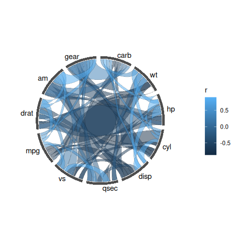
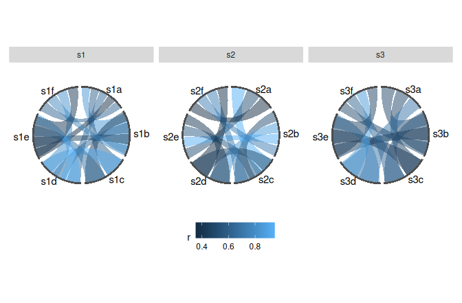
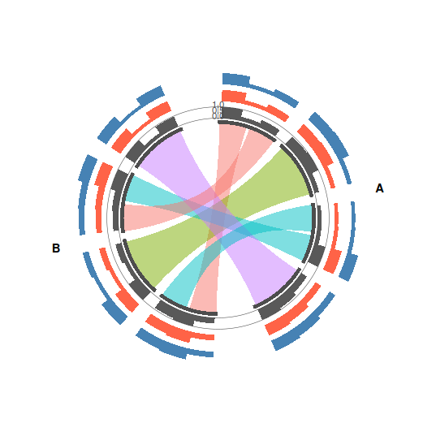
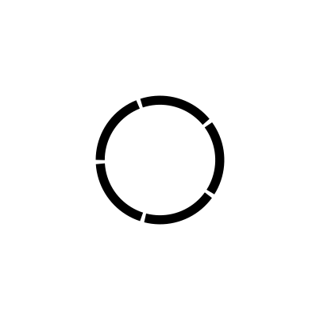

<!-- README is generated from README.Rmd. Please edit that file. -->

# ggcircos

> Circular layouts as ggplot2 data: chord diagrams, tracks and axes you
> can facet, scale, and compose.

**The one idea.** A circular layout is a *table of angles*. ggcircos
computes it once — every node’s arc, every link’s slot inside that arc —
and keeps it as data. From that, every layer is an ordinary ggplot2
layer: `scale_fill_*()` gives you a legend, `facet_wrap()` gives you
multiple rings, `patchwork` composes them, `saveRDS()` round-trips the
whole plot. This is what a base-graphics circos cannot do, and what
ggplot2 chord packages that draw one fixed diagram do not need.

``` r
install.packages("ggcircos")   # or:
remotes::install_github("YuLab-SMU/ggcircos")
```

## Thirty seconds

``` r
p <- ggcircos(cor(mtcars), order = "hclust") +
  geom_chord(aes(fill = r)) +
  geom_node_arc() +
  geom_node_text()
p
```



`ggcircos()` builds the layout and returns a plain `ggplot` object. The
geoms read the layout; they never recompute it.

## What this buys you

### Many rings from one layout (`facet_wrap`)

Four samples, one shared node ring, one legend. `facet_wrap()` on a link
column splits the chords per panel — because the chords are just data
rows.

``` r
set.seed(42)
mk <- function(s) {
  m <- matrix(runif(8 * 8), 8, 8); m <- (m + t(m)) / 2; diag(m) <- 0
  d <- as.data.frame(as.table(m)); names(d) <- c("from", "to", "r")
  d$sample <- s; d
}
links <- do.call(rbind, lapply(1:4, mk))

ggcircos(links, order = "hclust") +
  geom_chord(aes(fill = r)) +
  geom_node_arc() +
  geom_node_text() +
  facet_wrap(~ sample) +
  theme_circos(legend.position = "bottom")
```



### Tracks, an axis, and sectors

`tracks =` declares radial bands outside the node ring; `geom_track()`
plots into one; `geom_track_axis()` puts a readable ruler on it. Bands
never overlap each other or the ring.

``` r
set.seed(7)
nodes <- data.frame(
  id = c(paste0("g", 1:4), paste0("h", 1:4)),
  genome = rep(c("A", "B"), each = 4)
)
links2 <- data.frame(
  from = c("g1", "g2", "g3", "g4", "g1", "g3"),
  to   = c("h1", "h2", "h3", "h4", "h3", "h1")
)
trk <- data.frame(
  id = rep(nodes$id, 3),
  value = runif(24, 0.2, 0.9)
)

ggcircos(links2, nodes = nodes, sectors = "genome",
         tracks = c(gc = 0.12, depth = 0.12, gene = 0.12)) +
  geom_chord(aes(fill = from)) +
  geom_node_arc() +
  geom_track(data = trk, aes(x = value), node = id, band = "gc") +
  geom_track(data = trk, aes(x = value), node = id, band = "depth",
             fill = "tomato") +
  geom_track(data = trk, aes(x = value), node = id, band = "gene",
             fill = "steelblue") +
  geom_track_axis(band = "gc", limits = c(0, 1)) +
  geom_sector_label() +
  theme_circos(legend.position = "none")
```



### The layout is yours

`layout_nodes()` returns the angle table. Draw a node ring with nothing
but `geom_segment()` and `coord_circos()` if you want — the geoms in
this package are ordinary consumers of the same table.

``` r
nd <- layout_nodes(circos_layout(cor(mtcars)[1:5, 1:5], order = "hclust"))
nd
#>     id label sector order n_links   theta0   theta1     theta    width r
#> 1   hp    hp    all     1       4 0.000000 1.193805 0.5969026 1.193805 1
#> 2  cyl   cyl    all     2       4 1.256637 2.450442 1.8535397 1.193805 1
#> 3 disp  disp    all     3       4 2.513274 3.707079 3.1101767 1.193805 1
#> 4  mpg   mpg    all     4       4 3.769911 4.963716 4.3668138 1.193805 1
#> 5 drat  drat    all     5       4 5.026548 6.220353 5.6234508 1.193805 1
```

``` r
ggplot(nd, aes(x = 1, y = theta0)) +
  geom_segment(aes(x = 1, xend = 1, y = theta0, yend = theta1), linewidth = 4) +
  geom_point(aes(x = 1, y = theta), size = 2.5) +
  coord_circos(limits = c(0, 2 * pi)) +
  theme_circos()
```



## Inputs

| Input              | Example                                              |
|--------------------|------------------------------------------------------|
| correlation matrix | `ggcircos(cor(mtcars))`                              |
| link table         | `ggcircos(links, nodes = nodes, sectors = "genome")` |
| igraph / tbl_graph | `ggcircos(igraph::graph_from_data_frame(links))`     |

## Documentation

- `vignette("correlation")` — chord diagrams from a matrix: ordering,
  colour, sectors, input shapes.
- `vignette("tracks")` — tracks, axes, scales, tiles, facets.
- `vignette("from-circlize")` — the migration map, and an honest list of
  what ggcircos does not do yet.

## Status and limits

v0.1.0 targets **ggplot2 ≥ 4.0** only (it is built on `coord_radial()`).
Not yet: angular axes, interactive output. These are deliberate — see
`vignette("from-circlize")`.

## License

GPL-3.
