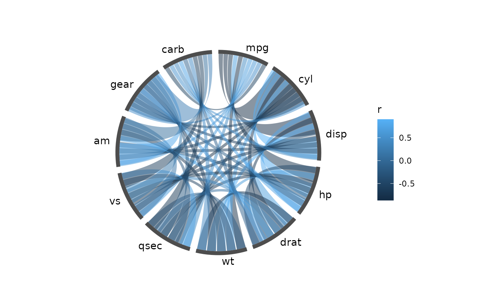

# Chord diagrams from a correlation matrix

``` r

knitr::opts_chunk$set(echo = TRUE, collapse = TRUE, comment = "#>")
library(ggcircos)
library(ggplot2)
set.seed(42)
```

## What a chord diagram is here

Each node owns an arc of the circle. Each link owns a *slot* inside the
arc of every node it touches, and is drawn as a ribbon between its two
slots. The arc width is proportional to the number of links a node
carries — not to the value of those links — so a busy node gets a wide
arc and its links fan out inside it. The value belongs to the ribbon’s
colour, not its foot.

ggcircos computes all of that once, into a plain table:

``` r

lay <- circos_layout(cor(mtcars), order = "hclust")
head(layout_nodes(lay))
#>     id label sector order n_links    theta0    theta1     theta     width r
#> 1 carb  carb    all     1      10 0.0000000 0.5083668 0.2541834 0.5083668 1
#> 2   wt    wt    all     2      10 0.5711987 1.0795655 0.8253821 0.5083668 1
#> 3   hp    hp    all     3      10 1.1423973 1.6507641 1.3965807 0.5083668 1
#> 4  cyl   cyl    all     4      10 1.7135960 2.2219628 1.9677794 0.5083668 1
#> 5 disp  disp    all     5      10 2.2847947 2.7931615 2.5389781 0.5083668 1
#> 6 qsec  qsec    all     6      10 2.8559933 3.3643601 3.1101767 0.5083668 1
```

Every geom in the package reads this table. None of them recompute it.
That one decision is what makes the rest of this vignette — and facets,
scales and legends — work the way they do in ggplot2.

## The thirty-second version

``` r

ggcircos(cor(mtcars), order = "hclust") +
  geom_chord(aes(fill = r)) +
  geom_node_arc() +
  geom_node_text()
```


A chord diagram of the mtcars correlation matrix.

Line by line:

- `ggcircos(cor(mtcars), order = "hclust")` builds the layout from the
  matrix and returns a plain `ggplot` object. It draws nothing itself.
- `geom_chord(aes(fill = r))` draws one ribbon per link, filled by the
  correlation value `r` (a matrix is turned into links with columns
  `from`, `to`, `r`).
- [`geom_node_arc()`](https://yulab-smu.github.io/ggcircos/reference/geom_node.md)
  draws the node ring just outside the circle of links.
- [`geom_node_text()`](https://yulab-smu.github.io/ggcircos/reference/geom_node.md)
  puts the node labels outside the ring.

The legend appeared without being asked for, because `fill` is a normal
ggplot2 aesthetic.

## Ordering the nodes

The order of the arcs is the layout’s only real degree of freedom. Three
ways to set it:

``` r

# 1. input order (the default)
ggcircos(cor(mtcars)) + geom_chord(aes(fill = r)) + geom_node_arc() + geom_node_text()
```



``` r

# 2. hierarchical clustering of the matrix
ggcircos(cor(mtcars), order = "hclust") +
  geom_chord(aes(fill = r)) + geom_node_arc() + geom_node_text()
```


Nodes ordered by hierarchical clustering: correlated variables end up
adjacent.

``` r

# 3. an explicit vector of node ids — it must list every node exactly once
ggcircos(cor(mtcars), order = c("mpg", "wt", "cyl", "disp", "hp", "drat",
                                "qsec", "vs", "am", "gear", "carb")) +
  geom_chord(aes(fill = r)) + geom_node_arc() + geom_node_text()
```


An explicit order vector: the strongest correlations are pulled together
by hand.

`order = "hclust"` clusters the matrix and lays the leaves out around
the circle. For a correlation matrix this is almost always what you
want: the blocks of variables that move together become adjacent arcs,
and the ribbons stop crossing the whole circle.

What the order actually changed, as data:

``` r

a <- layout_nodes(circos_layout(cor(mtcars)))
b <- layout_nodes(circos_layout(cor(mtcars), order = "hclust"))
data.frame(input_order = paste(a$id, collapse = " "),
           hclust_order = paste(b$id, collapse = " "))
#>                                    input_order
#> 1 mpg cyl disp hp drat wt qsec vs am gear carb
#>                                   hclust_order
#> 1 carb wt hp cyl disp qsec vs mpg drat am gear
```

## Colouring by value

`aes(fill = r)` maps a continuous variable; any ggplot2 fill scale
works, and the legend is automatic:

``` r

ggcircos(cor(mtcars), order = "hclust") +
  geom_chord(aes(fill = r)) +
  scale_fill_gradient2(low = "steelblue", mid = "white", high = "firebrick",
                       midpoint = 0, name = "r") +
  geom_node_arc() + geom_node_text()
```


A diverging scale: positive correlations warm, negative cool.

A discrete mapping is just as ordinary:

``` r

m <- cor(mtcars)
ggcircos(m, order = "hclust") +
  geom_chord(aes(fill = ifelse(r > 0, "positive", "negative"))) +
  geom_node_arc() + geom_node_text()
```


Ribbons coloured by sign, a factor-level fill.

One caveat worth knowing: a continuous fill is quantised into batches
before drawing (so a 500-link diagram is a few dozen grobs, not 500).
Each batch draws with one exact colour, at most 8/255 off any member.
Visually indistinguishable; bit-for-bit not identical.

## Letting the values drive the geometry

By default every node gets the same arc and every link the same share of
it: the layout only knows which nodes are connected, and the value shows
up as colour. That is the right picture when a link is a *relationship*
and all relationships count the same.

[`circlize::chordDiagram()`](https://rdrr.io/pkg/circlize/man/chordDiagram.html)
does the opposite: a node’s arc is proportional to the weight it
carries, and a link’s width is proportional to its own value. `weight =`
switches ggcircos to that behaviour:

``` r

ggcircos(cor(mtcars), order = "hclust", weight = r) +
  geom_chord(aes(fill = r)) +
  scale_fill_gradient2(low = "steelblue", mid = "grey95", high = "firebrick",
                       midpoint = 0, name = "r") +
  geom_node_arc() +
  geom_node_text()
```


weight = r: node arcs and link widths now follow the correlations, as
chordDiagram() does.

Read the difference off the ring: without `weight` every variable owns
`2*pi/11` of the circle; with it `cyl`, `disp` and `mpg` are wide and
`am`, `qsec` are thin, because that is how much correlation they carry.
Negative values count by magnitude, so a strong negative correlation is
a wide link too.

``` r

nd <- layout_nodes(circos_layout(cor(mtcars), order = "hclust", weight = "r"))
round(setNames(nd$width / sum(nd$width), nd$id), 3)
#>  carb    wt    hp   cyl  disp  qsec    vs   mpg  drat    am  gear 
#> 0.070 0.103 0.099 0.114 0.111 0.069 0.091 0.110 0.086 0.075 0.072
```

`weight` names a column of the link table. A matrix supplies `r`; for a
link data frame pass whichever column holds the value, e.g.
`weight = "pident"` (or unquoted, `weight = pident`).

## Ribbons or curves

``` r

ggcircos(cor(mtcars), order = "hclust") +
  geom_chord(aes(colour = r), type = "line") +
  scale_colour_gradient2(low = "steelblue", mid = "grey80", high = "firebrick",
                         midpoint = 0) +
  geom_node_arc() + geom_node_text()
```


type = “line”: the same slots, drawn as curves.

`type = "line"` keeps the slot geometry — each link still leaves its
node at its own slot — but draws a curve instead of a filled ribbon.
With many links it stays readable where ribbons turn into mud.
`curvature` controls how far the ribbon bulges toward the centre; the
default `"auto"` scales it with the angular distance between the two
ends.

## Sectors

A sector is a group of nodes drawn with a wider gap around it — the way
circlize groups chromosomes. Pass a `nodes` table with an id column and
a column naming the sector, then point `sectors` at it:

``` r

nodes <- data.frame(
  id = c(paste0("ref", 1:4), paste0("qry", 1:4)),
  genome = rep(c("ref", "qry"), each = 4)
)
links <- data.frame(
  from = c("ref1", "ref2", "ref3", "ref1"),
  to   = c("qry2", "qry3", "qry4", "qry4")
)
ggcircos(links, nodes = nodes, sectors = "genome") +
  geom_chord(aes(fill = from)) +
  geom_node_arc() +
  geom_node_text() +
  geom_sector_label()
```


Two sectors (ref / qry) with a wider gap between them.

[`geom_sector_label()`](https://yulab-smu.github.io/ggcircos/reference/geom_sector_label.md)
labels the sector, not the node; it uses the ring-contiguous run of each
sector’s nodes, which is why a sector that straddles the start angle
still gets one label at its middle.

## Other input shapes

A link table is the general form — a matrix is just a shortcut for one:

``` r

head(data.frame(from = "mpg", to = "wt", r = cor(mtcars)["mpg", "wt"]))
#>   from to          r
#> 1  mpg wt -0.8676594
```

Graph objects work directly:

``` r

g <- igraph::graph_from_data_frame(
  data.frame(from = c("a", "b", "c", "d"),
             to   = c("b", "c", "a", "a"),
             w    = c(3, 1, 2, 4))
)
ggcircos(g) + geom_chord(aes(fill = w)) + geom_node_arc() + geom_node_text()
```


An igraph object: the same layout machinery, fed from a graph.

[`tidygraph::tbl_graph`](https://tidygraph.data-imaginist.com/reference/tbl_graph.html)
works the same way. What the package reads natively is: a square
symmetric matrix, a data frame with `from`/`to`, an igraph or tbl_graph
object. Anything else becomes one of those three before the layout sees
it.

The *links* are all these have to offer. A node can also carry a range –
a gene on a chromosome, a confidence interval, a period – drawn in a
band around the ring. That is a track, and it takes `xmin`/`xmax`
instead of a single value:
[`vignette("tracks")`](https://yulab-smu.github.io/ggcircos/articles/tracks.md),
section “Genomic intervals”.

## Getting the layout back as data

The layout is not hidden inside the plot.
[`circos_layout()`](https://yulab-smu.github.io/ggcircos/reference/circos_layout.md)
returns it, and the `layout_*()` accessors return plain data frames:

``` r

lay <- circos_layout(cor(mtcars)[1:6, 1:6], order = "hclust")
layout_nodes(lay)
#>     id label sector order n_links   theta0    theta1     theta     width r
#> 1  mpg   mpg    all     1       5 0.000000 0.9843657 0.4921828 0.9843657 1
#> 2 drat  drat    all     2       5 1.047198 2.0315632 1.5393804 0.9843657 1
#> 3   wt    wt    all     3       5 2.094395 3.0787608 2.5865780 0.9843657 1
#> 4   hp    hp    all     4       5 3.141593 4.1259584 3.6337755 0.9843657 1
#> 5  cyl   cyl    all     5       5 4.188790 5.1731559 4.6809731 0.9843657 1
#> 6 disp  disp    all     6       5 5.235988 6.2203535 5.7281706 0.9843657 1
```

``` r

head(layout_links(lay))
#>   from   to          r self_loop .circos_w .circos_from_arc .circos_to_arc
#> 1  mpg  cyl -0.8521620     FALSE         1                1              5
#> 2  mpg disp -0.8475514     FALSE         1                1              6
#> 3  cyl disp  0.9020329     FALSE         1                5              6
#> 4  mpg   hp -0.7761684     FALSE         1                1              4
#> 5  cyl   hp  0.8324475     FALSE         1                5              4
#> 6 disp   hp  0.7909486     FALSE         1                6              4
#>   edge_id    theta0    theta1     theta theta_end0 theta_end1 theta_end x
#> 1       1 0.6004631 0.7776489 0.6890560   4.238008   5.123938  4.680973 1
#> 2       2 0.7973362 0.9745220 0.8859291   5.260597   5.703561  5.482079 1
#> 3       3 4.9393690 5.1608513 5.0501102   5.752780   6.195744  5.974262 1
#> 4       4 0.4035899 0.5807758 0.4921828   3.157999   3.453308  3.305654 1
#> 5       5 4.6932776 4.9147599 4.8040188   3.486121   3.781430  3.633776 1
#> 6       6 5.9086376 6.2039474 6.0562925   3.814243   4.109552  3.961897 1
#>           y xend     yend .circos_node_width .circos_loop_depth
#> 1 0.6890560    1 4.680973          0.9843657                0.5
#> 2 0.8859291    1 5.482079          0.9843657                0.5
#> 3 5.0501102    1 5.974262          0.9843657                0.5
#> 4 0.4921828    1 3.305654          0.9843657                0.5
#> 5 4.8040188    1 3.633776          0.9843657                0.5
#> 6 6.0562925    1 3.961897          0.9843657                0.5
```

Every column the geoms use is there: `theta0`/`theta1` are the node’s
arc, and a link’s `theta0`/`theta1` are the two slots it occupies. You
can filter it, join it, or feed it to your own geoms:

``` r

nd <- layout_nodes(lay)
ggplot(nd, aes(xmin = 1, xmax = 1.04, ymin = theta0, ymax = theta1)) +
  geom_rect(aes(fill = sector)) +
  coord_circos(limits = c(0, 2 * pi)) +
  theme_circos(legend.position = "none")
```


A hand-drawn node ring: geom_rect() over the layout table, no package
geoms.

This is the whole point of the design: the layout is data, the geoms are
consumers, and you are allowed to be one too.

## What this does not do yet

- No angular (clock) axis:
  [`geom_track_axis()`](https://yulab-smu.github.io/ggcircos/reference/geom_track_axis.md)
  is a radial ruler.
- Self-loops (`from == to`) need `self_loops = TRUE`; by default they
  are dropped with a message. With it, they are drawn as loops folded
  toward the centre (see
  [`vignette("from-circlize")`](https://yulab-smu.github.io/ggcircos/articles/from-circlize.md)).
- The y (angle) scale is fixed to `[0, 2*pi]` by the layout. Replacing
  it breaks angles, and the coordinate warns when you do.
