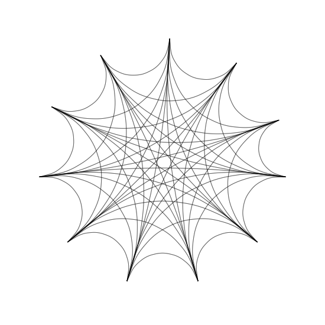
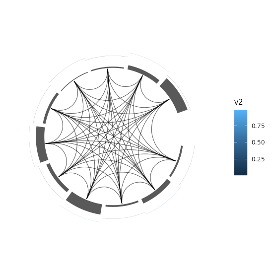
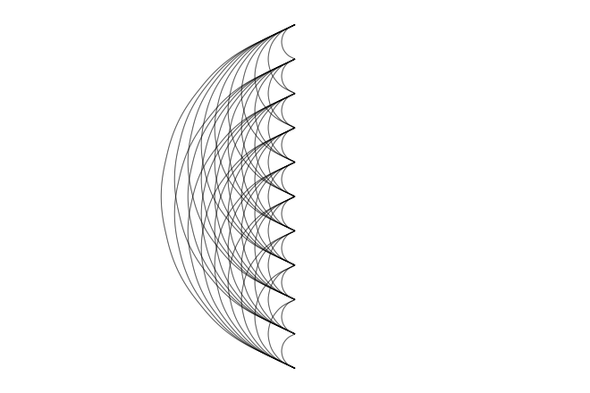
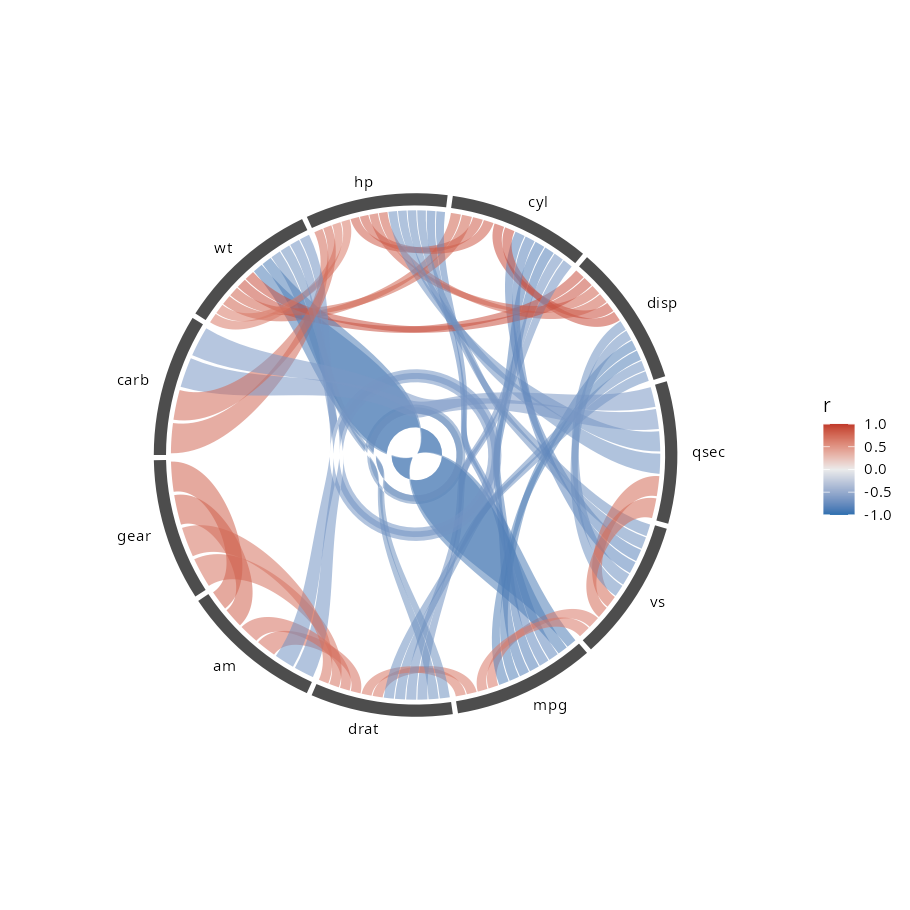

# ggcircos 复活提案

> 状态：提案（2026-10-19）。基于当前 master（`9732733`，2023-03-23）+ R 4.6.1 / ggplot2 4.0.3 / ggtree 4.2.0 / ggtreeExtra 1.23.1 实测。
> 结论先行：**代码现在还能画图，但骨架（"在图后面追加面板"）与 ggplot2 语法天然冲突，这才是当年停住的地方。复活 = 保留弦几何，重写外壳。**
> 具体到函数签名、列契约、错误与验收的实现规格见 [`spec.md`](spec.md)。

---

## 0. 一句话结论

这个包不是"写废了"，而是"卡在一个架构选择上"：它把 ggtreeExtra 的 `geom_fruit` 面板机制整段抄过来，用 `ggplot_add()` 往已有图上追加图层、用隐藏状态保存 layout。能出图，但每加一样新东西（多轨叠加、轴、线性布局、分面）都要自己发明一套坐标系语义——最后的证据就是仓库里那个被删掉的 `R/geom-rect-axis.R`（132 行、带 `print()` 调试、加了 `.gitignore`）。那是作者自己造 `geom_rect` + `pos_stackrect` 轴与堆叠堆到一半停下来的现场。

复活路线：**把 layout 变成数据（学 ggraph），把半径当 x、把角度当 y，然后一切交给 ggplot2 的 scale / stat / position / coord**。这样当年卡住的那三件事（轨道怎么叠、轴怎么画、角度怎么算）全都变成标准扩展点的常规工作。

---

## 1. 体检：现在到底能跑什么

### 1.1 环境与基线

| 项 | 结果 |
|---|---|
| `R CMD INSTALL` | OK（`corrr` 是硬依赖，本机原先未装，需先装） |
| `R CMD check --no-manual` | **0 ERROR / 1 WARNING**（`ggplot_add` 方法签名与 generic 不一致） |
| 基础弦图 | 能画，见 `figures/current-basic.png` |
| 标签层 `geom_link_lab()` | 能画 |
| 轨道 `geom_circos()`（col / tile / point / boxplot） | 能画 |
| `tbl_graph` 输入 | 能画 |
| 多轨叠加、分面、线性布局 | **不能**（见 1.2） |

所以"完全跑不起来"是误判。真正的问题是：**能画单层，不能组合；能跑，不"好用"。**



### 1.2 七个实测缺陷（都可以复现，脚本见附录 A）

**① 架构是 ggtreeExtra 的复制品，靠 15 个未导出内部函数活着**

`R/method-ggplot-add.R:58` 的 `ggplot_add.circos_panel` 与 `ggtreeExtra:::ggplot_add.fruit_plot` 逐行同构（对比过 1.23.1 源码），`R/reexports.R` 用 `getFromNamespace()` 抓了 ggtreeExtra 的 15 个内部函数：`reset_params`、`confuse_params`、`extract_dot_params`、`choose_pos`、`compute_aes`、`get_offset`、`dodpos`、`densitypos`、`idepos`、`stackpos`、`get_continuous_norm`、`normxy`、`build_axis`、`build_grid`、`check_orientation`。

ggtreeExtra 1.23 里面板方法已经叫 `ggplot_add.fruit_plot`（类 `fruit_plot`），而 ggcircos 抄的是一份更老的实现——少了 `limits`、`.set_pwidth2width`、dendrogram 分支这些后来补上的东西。这些内部函数今天还在，纯属运气。这意味着：**上游一次重构就能让整个包静默失效**，而且它永远拿不到上游后续的修复。

**② 图层顺序是硬约束**

```r
ggplot(tbl) + geom_circos(data = dat, geom = geom_col, mapping = aes(y = id, x = v1))
#> Error: no applicable method for 'left_join' applied to an object of class "NULL"
```

必须先 `ggcircos()` 建底图，再 `+ geom_circos()` 加轨道。这不是 ggplot2 的用法（ggplot2 里图层顺序只影响遮挡，不影响能否运行）。

**③ 多轨不叠加（最伤的一个）**

文档说 `offset` 是"层与层之间的距离"，实测两条轨道落在同一个半径带里：

```
layer 1 (弦)    x: 1.000 .. 1.000
layer 2 (轨道1) x: 0.017 .. 0.247
layer 3 (轨道2) x: 0.001 .. 0.148      <- 从同一半径起算，被轨道1盖住
```

见 `figures/current-tracks.png`：第二条轨道叠在第一条的内侧而不是外侧。原因是"带基"被三套互不相认的机制分别计算：`get_continuous_norm()`（连续值）、`normxy()+offset`（离散值）、`position$hexpand`（有 `hexpand` 参数的 position）。三者从来没有对齐过。



**④ 标签角度是手算的，和 `coord_polar` 的真实映射对不上**

`R/utilities.R:56` 用 `360/(diff(range(y))+1)*y` 推算角度（随 y 递增），但真实屏幕角度由 `coord_polar(start=-pi/2)` + `scale_y_continuous(expand=c(0,0.6,0,0.2))` 决定，是**随 y 递减**的。实测（11 个节点）：

```
记录  : 32.7  65.5  98.2 130.9 163.6 196.4 229.1 261.8 294.5 327.3 360.0
真实  : 160.0 126.7 93.3  60.0  26.7 353.3 320.0 286.7 253.3 220.0 186.7
```

`geom_link_lab()` 用记录的 `angle` 同时决定"画在哪个半圆"和"旋转多少度"，于是：

- 右半圆判定：代码得 `{mpg, cyl, am, gear, carb}`，真实应为 `{hp, drat, wt, qsec, vs}`——**11 个错 6 个**；
- 旋转角误差最大 **155°**（`vs`）、118°（`cyl`）、109°（`hp`），一半标签是歪的或倒的。

这是"手算几何"必然的结果：角度一旦由 `expand` 或 `start` 改变就不再成立，而这个数字还被硬编码在 `geom_link_lab()` 的 `angle+180`、`subset` 字符串里。

**⑤ 数据里的 join 键被吃掉，映射不上第二个美学**

`data` 里用来映射 `y` 的那一列，在 `left_join(by = c("label" = y))` 里被当 key 消耗掉，画到图层时列已经不存在：

```r
p + geom_circos(data = dat, geom = geom_col, mapping = aes(y = id, x = v1, fill = id))
#> Error: object 'id' not found
```

**⑥ 隐藏状态，导致分面直接报错**

layout 存在 `plot$plot_env`（`ggcircos.R:45` 的 `assign("layout", layout, envir = p$plot_env)`），节点表存在 `plot$data` 的属性里。后果：

```r
p + geom_circos(...) + facet_wrap(~ id)
#> Error: At least one layer must contain all faceting variables: `id`
```

分面、`plotly::ggplotly()`、保存/重载对象、把 plot 当普通对象传递——全都不安全。

**⑦ 线性布局是坏的**

`figures/current-linear.png`：所有弦从同一条竖线出发，曲率溢出面板被裁掉（`scale_x_continuous` 只为 x 预留了 0.1 的 expand，而曲率最大可以吃掉 0.8 个面板宽度）。`direction` 参数是半成品。



### 1.3 数据模型缺一层

现在的模型是"一个环 + 一串节点 + 一堆边"。没有 **sector / block / gap** 概念，所以：

- 环上不能分块，块间不能留缝；
- 两个基因组（BLAST / BRIG 那种左右两条弧）根本表达不了——这正是仓库里**唯一一个 open issue**（#1，2023-04，"is it possible to visualize blast result that is similar to brig"）；
- 每条边在节点弧上没有"槽位"，所有弦都从节点中心点发散，所以出图是"蜘蛛网"而不是"circos"（对比 `figures/target-design.png`）。

### 1.4 工程债（不影响跑，影响"能用"）

- `DESCRIPTION` 是占位符：Title "What the Package Does (One Line, Title Case)"，Description 同款。
- 没有 README、没有 vignette、没有 `tests/`、没有 pkgdown。
- `aes_()` / `aes_string()`（ggplot2 3.0 起弃用）、`size` 画线（应 `linewidth`）。
- `tidygraph` 只在 `Suggests`，却在顶层 `getFromNamespace()`（`R/utilities.R:70`）——装包时缺 tidygraph 就炸。
- `R/geom-utilities.R` 里三份 `generate_curvature*()` 是死代码（只有 `build_curvature()` 被调用）。
- `%|||%` 的语义是"长度不同就返回 y"，不是常规的空值兜底。
- `tl_extract(name)` 文档写"character"，实现却要 quosure（`tl_extract(name = "node")` 能跑，传 symbol 就报 `Can't convert a call to a string`）。

---

## 2. 当年为什么走不下去

一句话：**把"环外轨道"当成"往图上追加图层"，就必须自己发明坐标系语义。**

半径从哪起算？多轨怎么叠？轴画在哪？断点怎么定？这些在 ggplot2 里分别由 scale、position、guide、scale 负责。抄 ggtreeExtra 只抄到了"实现"，抄不到"契约"——因为 ggtreeExtra 的宿主是 ggtree，树已经给了 x 的含义（到根的距离）和整套 scale。ggcircos 没有宿主，于是每一样都要自己造，于是停在 `geom_rect_axis` / `pos_stackrect`。

**修修补补（把 `get_continuous_norm` 分支补上 offset）能让多轨叠起来，但不会让它变好用**：多轨、轴、线性布局、分面还要各造一套。所以提案建议的不是补丁，而是把外围重写。

---

## 3. 目标语法：真的按 ggplot2 来

五条设计原则：

1. **data first**：`ggcircos(data)` 像 `ggplot(data)`，数据里有 from/to 就能画。
2. **layout 是数据，不是状态**（学 ggraph）：所有坐标在 `ggcircos()` 里一次算完，落在数据的列上；之后的每个图层都只是普通图层。
3. **每个扩展点只做一件事**：Stat 做归一化、Position 做堆叠、Geom 画、Coord 定角度。不跨层解决同一个问题。
4. **θ 就是 y**：y 直接是弧度，不再有"节点序号 → 角度"的手工换算，标签旋转、`clip`、轴断点全部由真实坐标推导。
5. **能 scale、能 facet、能 theme**：这是"好用"的硬指标，不是加分项。

### 3.1 目标 API

| 新函数 | 角色 | 对应 ggplot2 概念 |
|---|---|---|
| `ggcircos(data, nodes, sectors, layout, order, gap, start)` | 建底图，算出 layout / 槽位 / 坐标 | `ggplot()` + `coord_*()` |
| `coord_circos()` / `coord_arc()` | 圆形 / 线性坐标系（`clip="off"`、起点、方向） | `coord_polar()` 的超集 |
| `geom_chord(aes(from, to), type = c("ribbon","line"))` | 弦（带状或线状），曲率自动 | `Geom` + `Stat` |
| `geom_node_text/point/col/arc()` | 节点层的文本 / 点 / 色块 / 弧 | `geom_text()` 等的环形版本 |
| `geom_track(geom, band, stack)` | 环外轨道（bar / tile / point / boxplot …） | `Stat` 归一化 + `position_stack()` |
| `geom_track_axis()` | 轨道轴与断点 | `guide` 的图层版 |
| `theme_circos()` | 去网格 / 去轴 / 留白 | `theme_void()` 的环形版 |
| `layout_circos()`（内部） | 节点→弧、边→槽位、sector 分块 | 纯函数，可单测 |

旧名字保留为 deprecated shim：`geom_curve_link()` → `geom_chord()`，`geom_circos()` → `geom_track()`，`ggcircos()` 名字不变、语义升级。

### 3.2 用法长什么样

**A. 相关性弦图**（对比 `figures/current-basic.png`）

```r
cor_mat <- cor(mtcars)

ggcircos(cor_mat, order = "hclust", gap = 0.02) +
  geom_chord(aes(fill = r), alpha = 0.5, type = "ribbon") +
  geom_node_arc(width = 0.05) +
  geom_node_text() +
  scale_fill_gradient2(midpoint = 0) +   # 普通 scale，不需要 ggnewscale
  theme_circos()
```

`order = "hclust"` 是布局参数（也可以传一个显式的字符向量），`fill = r` 直接来自 links 数据——因为 `r` 是数据列，不是包的内部状态。

**B. BLAST / BRIG 式双基因组**（现在完全做不到）

```r
ggcircos(
  links,
  nodes  = nodes,                 # 节点表：name, genome, start, end
  sectors = "genome",             # 按 genome 分块，块间留缝
  gap = 0.03,
  sector_gap = 0.12
) +
  geom_chord(aes(fill = identity), type = "ribbon") +
  geom_node_arc(aes(fill = genome), width = 0.04) +
  geom_sector_label()
```

**C. 轨道 + 轴**

```r
ggcircos(cor_mat, tracks = c(values = 0.20, heat = 0.10)) +
  geom_chord(aes(fill = r)) +
  geom_track(aes(x = value), node = id, geom = "col",  band = "values") +
  geom_track(aes(fill = z),  node = id, geom = "tile", band = "heat") +
  geom_track_axis(band = "values", limits = c(0, 1), breaks = 4)
```

`band` 用名字引用 `ggcircos(tracks = ...)` 里声明的带；也可以直接给 `band = c(0.05, 0.25)` 显式半径区间——两种写法都行，都是**数据**，不是隐藏状态。

**D. 线性 / 弧图**

```r
ggcircos(links, layout = "arc") +   # 等价于 coord_arc() + 同一套图层
  geom_chord(curvature = "auto")
```

### 3.3 目标效果

下面的图是用**纯 ggplot2**（`geom_polygon` + `geom_rect` + `geom_text` + `coord_polar` + `scale_fill_gradient2`）手写 60 行搭出来的设计验证，没有任何 ggcircos 代码：它证明目标语法需要的东西 ggplot2 已经全部提供，我们只需要把坐标算好。



对比 `current-basic.png` 能看出差距来自哪里：**每根弦在两个节点弧上各占一个槽位**（而不是从节点中心点发散），节点弧之间留缝，`order = "hclust"` 排序。

---

## 4. 关键设计决策（都已经验证过）

### 4.1 轨道堆叠：不要自造 position，用现成的

当年卡在 `pos_stackrect`。实测表明**不需要**：

```r
# 每个节点把值归一化到宽度 0.2 的带内，然后交给 ggplot2 自己叠
d <- within(d, x <- 0.2 * val / ave(val, id, FUN = sum))
ggplot(d) + geom_col(aes(x, id, fill = grp), orientation = "y",
                     position = position_stack(reverse = TRUE)) +
  coord_polar(theta = "y")
```

`figures/proto-position-stack.png` 就是这个 30 行原型：轨道内堆叠、第二条轨道用 `+ 0.25` 平移即得同心双轨。**归一化放 Stat，堆叠放 Position，不写一行自定义堆叠代码。**

### 4.2 槽位分配是 layout 的核心

"蜘蛛网 vs circos"的差别不在 Geom，在 layout：每条边要在两端的节点弧上各分到一段角度。这是纯函数、可单测、可写成：

```r
slots <- allocate_slots(nodes, links)   # 返回 links 加 4 列：theta0/theta1/theta_end0/theta_end1
```

Geom 拿到的是已经算好的弧度，画弧、画贝塞尔、算曲率都是常规活儿。旧代码把"曲率"直接塞进 `draw_panel` 用节点中心点现推（`build_curvature()` 的 4 段 if-else），正是因为它没有这一层。

### 4.3 角度一律从真实变换取

弦层已经在 `draw_panel` 里用 `coord$transform()` 取真实 θ（这部分是对的，保留）；标签层应照做，而不是用 `360/(diff+1)` 另算一套。改完之后"y 就是弧度"，`coord_circos()` 的 `start`/`direction` 怎么改都不会再错。

### 4.4 依赖：把 ggtreeExtra 的 15 个内部函数 vendor 进来或重写

目标是把 `ggtreeExtra`、`ggtree`、`ggfun`、`yulab.utils` 从 `Imports` 里去掉（它们存在的唯一原因是抄来的面板代码需要它们）。剩下的依赖应该只有 `ggplot2`、`rlang`、`cli`，`tidygraph`/`igraph`/`corrr` 进 `Suggests`。这同时打开 CRAN / r-universe 的可能（Bioconductor 那套位置函数的依赖链就去掉了）。

---

## 5. 分阶段计划

每个里程碑都能单独验收，且都留下可运行的东西。

### M0 — 止血（1–2 天）

不改架构，只让现在的包"不骗人"：

- `geom_circos()` / `ggcircos()` 里把"多轨叠加"的真实行为写进文档，或者干脆让 `offset` 真的累加（把 `get_continuous_norm` 分支改成基于 `xmaxtmp`）；顺带修 join 键被吃（⑤）、标签角度（④）、线性布局裁切（⑦）。
- `DESCRIPTION` 换成真的标题/描述；补 README；`aes_`/`aes_string` 换成 tidy eval；`size` → `linewidth`。
- 加 `tests/testthat/`：至少覆盖"装得上 / 建图不报错 / 两轨不相交"。
- `R CMD check` 清零 WARNING。

**验收**：`make check1` 0 ERROR 0 WARNING；两轨的 `x` 区间不重叠；`fill = 节点列` 能跑。

### M1 — 骨架（约 1 周）

- 新 `ggcircos()`（layout 当数据、`order`/`gap`/`start`/`sectors` 参数）+ `coord_circos()`。
- `layout_circos()`：节点弧、sector 分块、槽位分配（纯函数 + 单测）。
- `geom_chord()`：`ribbon` / `line` 两种，`curvature = "auto"`，`linewidth`/`fill`/`alpha` 正常吃 aesthetics。
- `geom_node_arc()` / `geom_node_text()`（旋转用真实 θ）/ `geom_sector_label()`。
- 旧函数变 deprecated shim，`R CMD check` 对旧用法给 warning 而不是 error。

**验收**：`ggcircos(cor(mtcars), order="hclust") + geom_chord(aes(fill=r)) + geom_node_text() + theme_circos()` 与 `figures/target-design.png` 视觉一致；`facet_wrap()` 不再报错（哪怕是空分面）；`vdiffr` 快照入库。

### M2 — 轨道与外圈（约 1 周）

- `geom_track()`（col / tile / point / text 至少四种，boxplot/violin 走 position 分支）+ `band` 声明。
- `geom_track_axis()`（替代抄来的 `build_axis`）、`theme_circos()`。
- `layout = "arc"` + `coord_arc()`，线性布局与圆形共享同一套图层。
- 多轨、多 sector、分面三组回归测试。

**验收**：3.2 的三段示例全部可跑；两条轨道半径区间不相交；`facet_wrap(~ group)` 出多环。

### M3 — 打磨（3–5 天）

- 3 篇 vignette：`correlation`（弦图）/ `genomes`（sector + 双基因组）/ `tracks`（轨道与轴）。
- README + pkgdown + 图库（全部用最终语法生成）。
- 版本 `0.1.0`，NEWS 写清楚破坏性变更，打 tag。

**验收**：`make check`（含 vignette 构建）通过；pkgdown 站点无 error。

---

## 6. 风险与取舍

| 风险 | 判断 |
|---|---|
| 破坏性改名 | 仓库 3 star / 1 fork、无 CRAN 版本、0.0.0.9000，基本没有外部用户。可以在 0.1.0 里直接改，用 shim 兜一层。 |
| 与 ggtreeExtra 重复 | 明确分工：ggtreeExtra 做"树的外圈"，ggcircos 做"非树的关系图"。共享的只有位置函数，新设计不再依赖它们。 |
| ggplot2 4.0 的 S7 影响 | 实测 `ggplot_add()` 仍可用，`themes`/`coords` 也都正常；`%+%` 弃用不影响本包。M1 用 ggplot2 3.5 + 4.0 双版本 CI。 |
| 槽位分配复杂（一条边两端各占一段，且要跟 sector 对齐） | 这是唯一真正有算法含量的部分，也是最该先写单测的部分（M1 第一天）。 |
| 维护成本 | 新骨架约 600–800 行，比现在 1300 行少，且不再跟上游内部函数耦合。 |

---

## 7. 一句话的取舍建议

如果只想"能用"：做 M0，两天，把七个缺陷修掉，包就自洽了。
如果想"好用、能被别人用"：M0 + M1 是不可跳过的，轨道和 sector 可以放到 M2 再看——因为**弦图（M1）覆盖了 80% 的真实用途**，而 BLAST/BRIG 场景（M1 的 sector + M2 的轨道）是它唯一可能出圈的地方。

---

## 附录 A：复现脚本

```r
## 装
# install.packages("corrr")
# R CMD INSTALL .

## ① 多轨不叠加
set.seed(7); library(ggcircos); library(ggplot2); library(magrittr)
tbl <- cor(mtcars) %>% as.tbl_lk()
dat <- data.frame(id = colnames(mtcars), v1 = runif(11), v2 = runif(11))
q <- ggcircos(tbl) +
  geom_circos(data = dat, geom = geom_col, mapping = aes(y = id, x = v1), pwidth = .25) +
  geom_circos(data = dat, geom = geom_col, mapping = aes(y = id, x = v2), pwidth = .15)
b <- ggplot_build(q)
range(b$data[[2]]$x)   # 0.017 .. 0.247
range(b$data[[3]]$x)   # 0.001 .. 0.148  <- 同一个带

## ② 图层顺序
ggplot(tbl) + geom_circos(data = dat, geom = geom_col, mapping = aes(y = id, x = v1))
#> Error: no applicable method for 'left_join' applied to an object of class "NULL"

## ④ 标签角度（真实屏幕角度 = 180 - 360*(y-min)/span）
nodes <- attr(ggcircos(tbl)$data, "node")
tr <- ggplot_build(ggcircos(tbl))$layout$panel_params[[1]]$theta.range
screen <- (180 - 360*(nodes$y - tr[1])/diff(tr)) %% 360
cbind(label = nodes$label, recorded = round(nodes$angle,1), screen = round(screen,1))
# 右半圆：代码 angle<90|angle>270 -> mpg cyl am gear carb
#         真实 screen<90|screen>270 -> hp drat wt qsec vs

## ⑤ join 键被吃
ggcircos(tbl) + geom_circos(data = dat, geom = geom_col,
                            mapping = aes(y = id, x = v1, fill = id))
#> Error: object 'id' not found

## ⑥ 分面
ggcircos(tbl) + geom_circos(data = dat, geom = geom_col, mapping = aes(y = id, x = v1)) +
  facet_wrap(~ id)
#> Error: At least one layer must contain all faceting variables: `id`
```

```bash
# 检查基线
cd .. && R CMD build ggcircos && R CMD check ggcircos_0.0.0.9000.tar.gz --no-manual
```

## 附录 B：与相邻项目对比

| | ggcircos（现在） | ggcircos（目标） | ggraph | circlize | ggbio |
|---|---|---|---|---|---|
| 语法 | 仿 ggplot2（ggplot_add 追加） | 真 ggplot2（coord + geom + scale） | 真 ggplot2 | base graphics | 真 ggplot2 |
| 布局是数据 | 否（隐藏状态） | 是 | 是 | 不适用 | 部分 |
| 分面 | 报错 | 支持 | 支持 | 不支持 | 支持 |
| sector / 块 | 无 | 有 | 不适用 | 有 | 有 |
| 弦的槽位分配 | 无（中心点发散） | 有 | 边几何，无槽位 | 有 | 部分 |
| 轨道 + 轴 | 有但半成品 | 有 | 不适用 | 有 | 有限 |
| 依赖 | ggtreeExtra 内部 ×15 | ggplot2 + rlang | ggplot2 生态 | grid | 重 |

ggraph 是最值得抄的对象：它证明了"布局当数据 + 普通 geom"这条路能让网络图完全 ggplot2 化；ggcircos 只需要把 ggraph 的 `layout_*` 换成 `layout_circos`，把 `geom_edge_arc` 换成 `geom_chord`。
